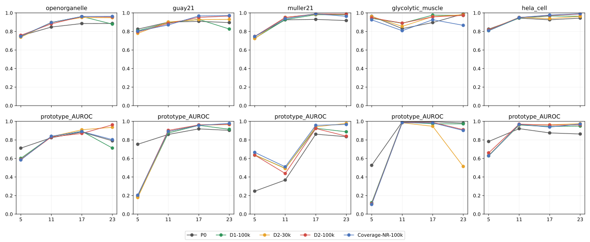
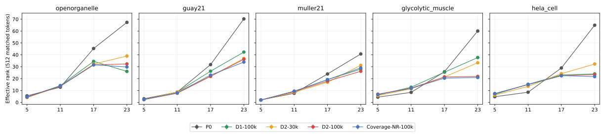
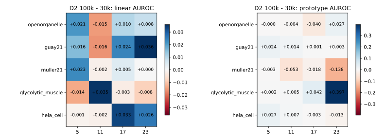

# Feature Mechanism Pilot A：实测结果与研究裁决

2026-10-27完成；仅执行Pilot A。正式结果以本文、`reviewed_verdicts.json`及CSV为准。

## 实验发现

**D2的肌肉分割退化在简单冻结线性读出中复现，深层谱压缩也确实存在；但本轮没有建立“持续SSL导致稳定语义混淆，再通过周期纹理捷径产生误检”的完整证据链。** 最值得研究的单一候选机制是：跨域背景响应相对于固定分割决策边界发生偏移，而前景/背景排序能力仍大体保留。

| 问题 | 裁决 | 证据与范围 |
|---|---|---|
| 1. 稳定的语义可分性下降？ | INCONCLUSIVE | 肌肉linear AUROC在5/23层下降、11层上升、17层区间跨0；prototype四层点估计均上升，23层0.5138→0.9105。 |
| 2. 变化集中在哪一层？ | SUPPORTED | 肌肉有效秩33.3074→21.8166，五来源23层均下降；语义退化的统一层位仍INCONCLUSIVE。 |
| 3. 简单读出复现分割退化？ | SUPPORTED | 23层linear Dice0.5090→0.2906、远端FP率0.003088→0.097238；已有Primus同视野Dice0.4785→0.2018。 |
| 4. 周期性与误激活稳定正相关？ | INCONCLUSIVE | Primus rho0.0914，Z块95%区间[-0.0132,0.1866]；linear23原始rho为负、控制后接近0，证据依赖读出与控制方式。 |
| 5. 足以支持具体预训练约束？ | INCONCLUSIVE | 深层谱压缩和分割退化已观测到，语义混淆及周期纹理机制证据未闭合；本轮不据此实施Topo-Anchor。 |

### 1. 分割退化复现，但排序与阈值输出不同步

下表仅统计预先锁定的64个肌肉随机native256视野，按有效像素计数汇总；不是MB-1全体积成绩。Linear23为本轮仅用MV3 train拟合的读出，Primus为既有seed20261014预测。历史错误导向案例不进入表内。远端FP率分母是远端有效背景像素，非全部图像像素。

| 模型 | 读出 | Dice | Precision | Recall | 远端FP率（%） |
|---|---|---|---|---|---|
| P0 | 23 | 0.4635 | 0.6515 | 0.3597 | 0.0306 |
| P0 | Primus | 0.7440 | 0.9201 | 0.6245 | 0.0295 |
| D1-100k | 23 | 0.5498 | 0.6256 | 0.4904 | 0.0382 |
| D1-100k | Primus | 0.6475 | 0.9363 | 0.4948 | 0.0031 |
| D2-30k | 23 | 0.5090 | 0.5362 | 0.4845 | 0.3089 |
| D2-30k | Primus | 0.4785 | 0.7388 | 0.3539 | 0.2617 |
| D2-100k | 23 | 0.2906 | 0.1775 | 0.8019 | 9.7238 |
| D2-100k | Primus | 0.2018 | 0.1373 | 0.3804 | 7.5009 |
| Coverage-NR-100k | 23 | 0.0910 | 0.0483 | 0.7844 | 48.3812 |
| Coverage-NR-100k | Primus | 0.4182 | 0.5335 | 0.3439 | 0.7347 |

D2/30k→100k：Linear23 Dice变化−0.2184、Precision下降、Recall上升；远端FP率0.31%→9.72%。已有Primus同视野Dice0.4785→0.2018、远端FP率0.26%→7.50%。因此退化不只出现在Primus的复杂解码过程中。Coverage-NR的Linear23更差而Primus有所恢复，也显示读出机制具有实质影响。

### 2. 特征可分性没有一致下降

使用相同392个前景patch和13,397个远端背景patch，以下AUROC只衡量固定train-only读出的排序；不使用肌肉GT拟合。区间按同一volume内Z//8块配对bootstrap 200次（28块），描述采集内不确定性。

| 层 | 读出 | D2/30k | D2/100k | 变化 | Z块95%区间 |
|---|---|---|---|---|---|
| 5 | linear | 0.9609 | 0.9470 | -0.0138 | [-0.0196, -0.0089] |
| 5 | prototype | 0.1092 | 0.1116 | +0.0024 | [-0.0004, 0.0049] |
| 11 | linear | 0.8547 | 0.8901 | +0.0354 | [0.0201, 0.0508] |
| 11 | prototype | 0.9845 | 0.9898 | +0.0053 | [0.0024, 0.0091] |
| 17 | linear | 0.9602 | 0.9577 | -0.0026 | [-0.0104, 0.0076] |
| 17 | prototype | 0.9470 | 0.9891 | +0.0422 | [0.0201, 0.0658] |
| 23 | linear | 0.9811 | 0.9727 | -0.0083 | [-0.0212, -0.0008] |
| 23 | prototype | 0.5138 | 0.9105 | +0.3968 | [0.3536, 0.4501] |

Linear23 AUROC从0.9811小幅降至0.9727，同时Dice大幅下降；Prototype23 AUROC却从0.5138升至0.9105。5层原型跨域方向反转（AUROC约0.11），保留真实分数方向，不根据评测标签翻转。简单读出与原型的差异提示可迁移决策方向、类先验与背景响应偏移值得研究；它们不能单独证明校准是唯一原因。

三种背景集合分别保留：

| 背景集合 | 背景patch数 | Linear AUROC 30k→100k | Prototype AUROC 30k→100k |
|---|---|---|---|
| 全部合格远端背景 | 13397 | 0.9811→0.9727 | 0.5138→0.9105 |
| 固定随机远端背景 | 1024 | 0.9787→0.9726 | 0.5158→0.9101 |
| D2/100k特定FP（事后） | 360 | 0.9915→0.9501 | 0.4099→0.8638 |

D2特定FP是由旧D2/100k预测条件化得到的有偏子集，仅用于解释错误。即使在这个集合上，100k的Linear23 AUROC仍为0.9501。完整类内/类间余弦与train中心化统计见[separability.csv](../experiments/Feature-Pilot-A/tables/separability.csv)。肌肉23层中心化类间余弦0.0930→0.1256，但Fisher ratio 0.8401→0.9336，同样不支持用一个几何统计概括为全面语义混淆。

### 3. 谱压缩集中在23层，且不与语义变化一一对应

| 肌肉层 | 有效秩30k→100k | Top-1方差份额30k→100k | 原始平均pair余弦30k→100k |
|---|---|---|---|
| 5 | 5.6252→6.8940 | 0.5113→0.4251 | 0.7744→0.8235 |
| 11 | 11.4374→11.9484 | 0.2642→0.3018 | 0.3470→0.3784 |
| 17 | 21.4293→21.3778 | 0.2188→0.2291 | 0.3348→0.3275 |
| 23 | 33.3074→21.8166 | 0.1789→0.2302 | 0.3960→0.3762 |

每项为三个固定、相同token位置子抽样的均值，每次512个token，中心化有效秩上限511；图中误差条是子抽样标准差。肌肉23层有效秩下降约34.5%，同时Top-1方差占比增加。这里的各向异性采用未中心化unit-token平均两两余弦，肌肉23层该值反而略降，说明谱集中与所有token朝同一方向聚集不是同一现象。

| 来源 | 23层有效秩30k→100k | Linear23 AUROC变化 | Prototype23 AUROC变化 | Linear23 Dice30k→100k | Primus Dice30k→100k |
|---|---|---|---|---|---|
| OpenOrganelle | 38.9849→32.3258 | +0.0085 | +0.0265 | 0.6952→0.7183 | 0.8631→0.8974 |
| Guay | 36.9741→36.2491 | +0.0361 | +0.0029 | 0.4409→0.5056 | 0.7904→0.8053 |
| Müller | 31.1774→26.1835 | +0.0001 | -0.1383 | 0.5408→0.5152 | 0.8876→0.8852 |
| Glycolytic muscle | 33.3074→21.8166 | -0.0083 | +0.3968 | 0.5090→0.2906 | 0.4785→0.2018 |
| HeLa | 32.2478→23.3124 | +0.0257 | -0.0132 | 0.3660→0.6156 | 0.4616→0.6978 |

五来源23层有效秩均下降，而Guay、HeLa的Linear23 AUROC上升，Müller基本持平。谱压缩是实测现象；“谱压缩导致有害语义混淆”在这些对照中缺少一致对应。

图1：上行为固定线性读出AUROC，下行为MV3 train原型AUROC；背景为锁定随机视野内全部合格远端背景。

图2：每来源匹配512个token，三个固定子抽样；不是三次SSL seed。

图3：相同坐标D2/100k−30k。左右两面板色标范围不同，数值与区间见CSV。

### 4. 周期性关联较弱，且受读出和控制变量影响

肌肉559个合格远端背景64×64窗口中，固定4–32px频带的top4功率份额与D2/100k响应如下。对比度、梯度、XY位置、上下文GT密度和可变化的native spacing进入partial rank；区间仅对应未调整Spearman，未计算partial rank区间。

| D2/100k响应 | Spearman | Z块95%区间 | Partial rank |
|---|---|---|---|
| Primus_FP_fraction | 0.0914 | [-0.0132, 0.1866] | 0.0878 |
| linear_activation | -0.1703 | [-0.2780, -0.0889] | 0.0471 |
| linear_FP_fraction | -0.0847 | [-0.1798, -0.0054] | 0.0564 |

Primus的正向点估计弱且区间跨0；Linear23原始相关为负，控制后接近0。不能将其写成稳定的“周期越强、误检越多”。肌肉两个Y半区的Primus相关分别0.1203与0.0529；所有559窗口都落在train定义的最低对比度/低梯度档，因此这些分层在肌肉上实际只形成两个位置层，无法提供多个对比度档的复核。连续协变量partial rank仍使用肌肉内部变化。肌肉仅18nm/px一个物理尺度，不能从该来源内估计尺度效应；没有搜索或改变尺度。

其他来源同样单独报告，不跨域池化：

| 来源 | 远端窗口数 | D2/100k Primus rho | 控制后partial rank |
|---|---|---|---|
| OpenOrganelle | 80 | 0.0103 | -0.0099 |
| Guay | 731 | 0.0495 | -0.0321 |
| Müller | 693 | 0.2047 | 0.0031 |
| Glycolytic muscle | 559 | 0.0914 | 0.0878 |
| HeLa | 318 | 0.2525 | 0.1557 |

Müller的rho0.2047在控制后接近0；Guay调整后方向反转。HeLa保留一定正向描述性关联，但来源间差异阻止将其解释为统一因果机制。完整来源内、volume内和固定分层结果见[periodicity_correlations.csv](../experiments/Feature-Pilot-A/tables/periodicity_correlations.csv)。

## 仍无法解释的现象

本轮能够排除“肌肉分割退化只由Primus复杂解码过程产生”这一完整解释；轻量读出也发生退化。AUROC、原型方向和阈值分割的分歧，尚不能在表征几何变化、跨域前景先验偏移、probe拟合及校准之间确定唯一原因。Probe只覆盖156个train区域各2个视野，500次固定更新、单一诊断seed；这不是全MV3密集监督预算，也没有验证所有读出的优化收敛。

肌肉只有一个volume；Z块、相邻/重叠patch以及谱子抽样不构成独立生物重复。Guay的AUROC区间只有3个Z块，不能据此宣称跨独立acquisition显著。CSV的`acquisitions`按已知acquisition_id、缺失时按volume_id作分组标签计数，不能当作已核实的独立采集数。MB-1已参与研究决策，本轮属于已暴露数据诊断。

## 唯一机制建议与决策

**建议转向“跨域背景响应相对于固定决策边界的偏移”这一机制，暂不据本轮启动预训练结构保持约束。** 理由是D2/100k仍有较高的前景/远端背景排序AUROC，而0.5固定阈值下背景响应与FP大幅增加；这个矛盾比“特征整体坍塌”更符合当前直接证据。它是待检验的单一机制候选，不是本轮已经确认的校准原因。

本轮将“周期纹理捷径已获证实”与“Topo-Anchor由此必然有效”的主张撤下。若后续获授权开发预训练约束，应由新增机制证据决定约束对象，并与官方Gram Anchoring明确区分；当前没有方法有效性或新颖性结果。Pilot A已结束，Pilot B/C及其他训练保持未启动。

## 复现配置、资产与交付

- 固定seed20261027；312 train视野、320随机诊断视野、1历史错误案例，共633。五模型共享相同坐标及patch数量。样本表SHA256：`18622e1374467fe8a480f1b8a13e15370b51ac3386039d389bc4f55351c11458`。
- 官方ViT-L/16四层[5,11,17,23]，官方post-norm；每层patch缓存[633,256,1024]。CLS与4个register tokens单独保存，排除于patch统计。灰度原生256、不缩放，3通道重复，`((uint8/255)-0.5)/0.25`。
- BF16 autocast，post-norm特征统一存float16；原receipt的“精确表示BF16输出”描述有误，原输出dtype未捕获。保留原件及[精度更正](../evidence/Feature-Pilot-A/cache_precision_note.json)，五模型采用相同缓存精度。
- 每模型每层1025参数1×1 logistic probe，固定500 AdamW更新、lr0.03、wd0.001、batch4096；source均衡后class 50:50；固定final500及阈值0.5。所有12个train来源均有正负token，Wei前景仅5个，重复采样不增加独立监督量。
- Channel mean/std、前景/背景原型与周期性cutoffs仅从MV3 train拟合。20个probe完成并固定SHA后才读取诊断GT；MB1标签不参与拟合、调参或阈值选择。所有model/layer的训练minibatch坐标hash一致。
- GT前景patch占比≥0.5；有效像素≥95%；远端patch无前景且≥95%像素在原始完整XY标注平面距GT>180nm。全部远端背景指锁定随机视野内全部合格patch。另列每来源最多1024个固定随机远端patch，以及D2/100k历史Primus前景比例≥0.5的事后FP集合。
- 线性输出16×16概率双线性上采样到native256，阈值0.5。既有Primus为历史全图融合预测裁剪，两者空间上下文与容量不同；同一读出的D2时序比较保持设置一致。Han仍继承用户要求的整幅GT规则，不读取Han mask。
- 全部核心特征、probe拟合、谱、AUROC、距离与相关数值使用检查后空闲的物理GPU1/2/3。CPU负责I/O、调度、制图与最终CSV校验；GPU0禁用，网站7860最终HTTP200，服务inactive/MainPID0/退出0。
- 实际执行源码commit `772f0fb88fe2ebab3ce61cd39a483e1a44456a36`；最终制图/报告代码来自`5d6d6890b2524e34af5a0338c9fef5f82612bafb`，统计实现未改变。官方DINO源码commit `91ffb6803c74aeb6927209b82560142743763dd7`；环境见[environment_detail.json](../evidence/Feature-Pilot-A/environment_detail.json)。
- 数值分析阶段实测738.9秒；五模型各自特征+probe阶段13.2–19.5秒，并行运行，不能将这些时长相加当作总墙钟。下载、复核和Git交付另计。
- 历史五encoder在运行前及完成后均核验SHA不变。准确路径来自真实registry/resolved config，见[verified_models.json](../experiments/Feature-Pilot-A/verified_models.json)。

| 正式encoder | SHA256 |
|---|---|
| P0 | `8aa4cbddda325040fc78db2c272754af6ebe8ff2c55f6ec4f1964d8890f66035` |
| D1-100k | `7df9337dac1ef4775ff21727ddea48c6f265449ae22b24f4941c677fb00593db` |
| D2-30k | `7db12e7ff8bee45166aaeeda1d94365e696ddaecf0c57a0d1611a891cf0d3eda` |
| D2-100k | `92a81805f1cc126e1851d5c26baa0b5ba34597d8f93e29ac05203044fe6c7010` |
| Coverage-NR-100k | `a886d8b5447230b097bb2de06716d8f18ff51968b8837c122daf03e5a403293c` |

交付[完整CSV目录](../experiments/Feature-Pilot-A/tables)、[协议](../configs/evaluation/Feature_Pilot_A_protocol.json)、[锁定坐标](../experiments/Feature-Pilot-A/samples.json)、[最终裁决](../experiments/Feature-Pilot-A/reviewed_verdicts.json)、[运行索引](../experiments/Feature-Pilot-A/run_index.json)、[文件哈希清单](../evidence/Feature-Pilot-A/final_delivery_manifest.json)与[独立CSV复算](../evidence/Feature-Pilot-A/independent_validation.json)。

原始自动报告和自动verdict逐字保留在experiments/Feature-Pilot-A；其Q4只检查正向点估计和两个分层，未纳入块区间，最终审阅改为INCONCLUSIVE。自动Q2没有定位谱变化，本报告将SUPPORTED明确限定为23层谱压缩。所有原始CSV与自动报告保持服务器哈希。

三张统计图以SVG随PR提交；原图/GT/预测对照为`figures/muscle_examples_REVIEW_ONLY.png`，保留服务器与本机review artifacts，遵循仓库不提交原始图像的要求。对照图上行为锁定列表中的首个随机样本，下行为既有z150错误案例；linear面板为16×16概率（固定0–1色阶），Primus面板为二值预测。全部45个下载文件SHA匹配，含4张PNG。新特征缓存与probe权重只保留独立服务器目录。最终审阅版保存在本Git分支的docs目录，服务器自动报告原件保持。

独立draft PR：[PR #13](https://github.com/Polaris1010/EM-DINOv3-Research/pull/13)，base为`codex/coverage-nr-p0-training`；未自动合并。本轮工作记录见[work log 38](work_logs/20261027_38_feature_pilot_a.md)。CPU检查：registry生成一致、仓库验证PASS、unittest 51项通过（3项平台跳过）、独立CSV复算PASS；详见[检查收据](../evidence/Feature-Pilot-A/closeout_checks.json)。
