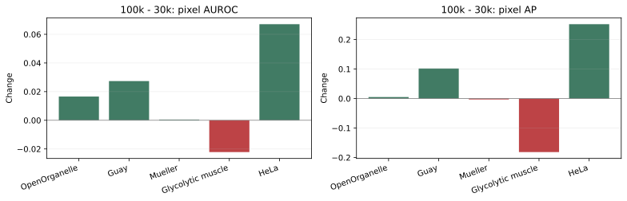
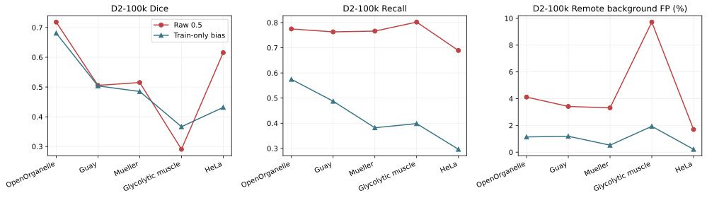
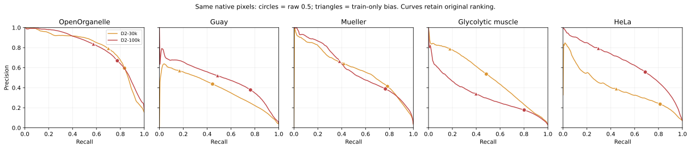

# Pilot A2：既有读出像素排序与全局偏置可修复性

2026-10-27香港完成。仅复用既有特征/概率/GT，使用物理GPU3；服务已停止，未训练ViT、Primus或Linear Probe。

本报告全部Dice、Recall及概率结果均来自Pilot A既有的**第23层冻结Linear Probe**及其原native256上采样，不能当作Primus或MB-1全体积结果。两个probe分别训练，encoder和头权重均保持只读。

## 三个结论

**1. 同像素排序确实退化。** 肌肉全部有效native像素AUROC从0.9429降至0.9207（−0.0222），AP从0.5043降至0.3228（−0.1816）。远端背景口径的AUROC/AP也下降，变化不限于紧贴边界的背景。上一轮高patch AUROC不能替代这一像素任务的判别能力。

**2. Train-only偏置只能部分改善肌肉误检，未完成保留其他来源的修复。** 100k肌肉Dice 0.2906→0.3666，远端FP率9.72%→1.93%，但Recall 0.8019→0.3986，损失40.34个百分点；其余四来源Dice点估计均下降，HeLa下降18.39个百分点。

**3. 结束“全局偏置作为主要修复”的方向，暂不投入Encoder空间共模机制开发。** 本轮直接验证的是既有读出的native像素排序退化及单一决策点修复的边界。两个Linear Probe分别训练，跨模型logit、偏置或分数分布变化不能归因于Encoder空间共模漂移；全局偏置失败也不能证明某个空间共模机制存在。本轮停止，不新增校准方法或训练。

## 1. 同口径pixel AUROC/AP变化

两个checkpoint使用完全相同的320个随机native256视野、有效像素和GT前景；每来源64个视野。主任务使用全部有效像素，前景/背景均为像素GT；AP为严格处理ties的阶梯Average Precision。下表不是完整MV3开发集或MB-1全体积重新评测。

| 来源 | AUROC 30k→100k | ΔAUROC | AP 30k→100k | ΔAP |
|---|---|---|---|---|
| OpenOrganelle | 0.9209→0.9374 | +0.0166 | 0.7955→0.8006 | +0.0051 |
| Guay | 0.9192→0.9465 | +0.0274 | 0.3853→0.4872 | +0.1020 |
| Müller | 0.9633→0.9638 | +0.0005 | 0.5863→0.5832 | -0.0031 |
| Glycolytic muscle | 0.9429→0.9207 | -0.0222 | 0.5043→0.3228 | -0.1816 |
| HeLa | 0.8762→0.9433 | +0.0671 | 0.3931→0.6454 | +0.2522 |

肌肉的配对变化及volume+Z//8块bootstrap 95%区间（28块、200次）：

| 像素范围 | ΔAUROC [95%区间] | ΔAP [95%区间] |
|---|---|---|
| 全部有效像素 | -0.0222 [-0.0366, -0.0107] | -0.1816 [-0.2355, -0.1331] |
| GT前景与远端背景 | -0.0291 [-0.0448, -0.0180] | -0.3162 [-0.3853, -0.2512] |

同一来源内GT前景比例保持一致，AP变化可直接配对。不同来源的AP不作为相同前景比例下的绝对难度比较。AUROC/AP来自原始连续概率，单调全局偏置不恢复这些排序指标。原始评分与最终阶段重复算得的ranking CSV字节一致。

## 2. 偏置如何确定

| 模型 | MV3-train-only全局偏置 | 等价原概率阈值 | 训练来源等权BCE 原始→修正 | 求解残差 |
|---|---|---|---|---|
| D2-30k | -1.63222310 | 0.83647395 | 0.144835→0.108752 | -1.14e-12 |
| D2-100k | -1.60702706 | 0.83299822 | 0.141217→0.104137 | -1.3e-12 |

严格使用原MV-Generalist-v2的312个固定训练视野（156个train区域，每区域2个），12来源等权、来源内部保留实际像素类别比例。来源等权前景比例为0.0918602。每模型只解一个全局BCE偏置，T=1，确定性一维二分，无网络梯度更新。两个模型都得到约−1.6的偏置，但这不是Encoder漂移量。

变换在已有概率双线性上采样完成之后：`q=exp(b)*p/(1-p+exp(b)*p)`，二值输出使用原概率与固定train-derived阈值比较。所有来源共用各模型唯一偏置。拟合求logit时固定epsilon=1e-6；训练像素截断比例30k为1.9213%、100k为1.7822%，实际输出保持原0/1端点。没有温度、来源专用参数或额外搜索。

按用户最新指定顺序分三个独立进程：原始评分→train-only拟合→冻结最终评分。原始评分读取MB1 GT仅计算指标；fit进程通过Python audit hook禁止读取evaluation_labels、MB1路径和baseline指标文件，仅按train坐标读取原MV缓存的GT/valid。算法与源码在原始评分前以commit锁定；偏置文件固定SHA后才进入最终评分及bootstrap，不根据中途成绩修改参数。

这312个视野曾用于probe拟合，因此偏置估计属于训练内诊断；评价仍是这些已暴露开发数据中的固定协议对照。

## 3. 肌肉恢复幅度与Recall代价

| 模型/操作点 | Dice | Precision | Recall | 远端FP率（%） | 预测前景（%） | Brier |
|---|---|---|---|---|---|---|
| D2-30k/raw | 0.509021 | 0.536177 | 0.484483 | 0.3089 | 2.7350 | 0.021924 |
| D2-30k/calibrated | 0.292835 | 0.787901 | 0.179837 | 0.0154 | 0.6909 | 0.021074 |
| D2-100k/raw | 0.290649 | 0.177488 | 0.801944 | 9.7238 | 13.6761 | 0.085400 |
| D2-100k/calibrated | 0.366640 | 0.339435 | 0.398585 | 1.9340 | 3.5543 | 0.033001 |

100k自身Dice增加0.075991（7.60个百分点），远端FP率相对减少80.11%；Recall减少0.403359（40.34个百分点）。概率Brier明显改善，但分割性能与召回的取舍仍不满足跨来源修复目标。固定原30k Dice作参照时，原始0.218372的差距只缩小34.80%，修正后100k仍低于原30k约0.1424。

| 100k修正−原始 | 配对变化 [95%区间] |
|---|---|
| dice | +0.0760 [+0.0252, +0.1157] |
| precision | +0.1619 [+0.1015, +0.2218] |
| recall | -0.4034 [-0.4380, -0.3697] |
| far_FP_rate | -0.0779 [-0.0931, -0.0614] |

### 为什么不能把校准后反超30k称为完全恢复

校准后100k Dice为0.366640，30k却从0.509021降至0.292835。双校准差距由−0.218372变成+0.073805，表面恢复量R=+0.292177。其中100k自身贡献+0.075991，30k变差贡献+0.216186，后者占R的73.99%。因此不能把R当作100k恢复幅度，更不能据此宣称消除了排序退化。

## 4. 其他来源是否保留

| 来源 | 100k Dice 原始→修正 | ΔDice | 100k Recall 原始→修正 | 远端FP率% 原始→修正 | Brier 原始→修正 |
|---|---|---|---|---|---|
| OpenOrganelle | 0.7183→0.6812 | -0.0371 | 0.7747→0.5746 | 4.118→1.139 | 0.0686→0.0621 |
| Guay | 0.5056→0.5038 | -0.0018 | 0.7631→0.4876 | 3.418→1.191 | 0.0422→0.0275 |
| Müller | 0.5152→0.4849 | -0.0303 | 0.7661→0.3821 | 3.313→0.523 | 0.0379→0.0220 |
| Glycolytic muscle | 0.2906→0.3666 | +0.0760 | 0.8019→0.3986 | 9.724→1.934 | 0.0854→0.0330 |
| HeLa | 0.6156→0.4316 | -0.1839 | 0.6890→0.2965 | 1.696→0.216 | 0.0448→0.0396 |

四个控制来源Dice点估计均下降，肌肉以外平均下降-6.33个百分点。五来源随机视野的来源等权Dice从0.529060降至0.493626（-3.54个百分点）。Brier在全部来源改善，表明train-only偏置可改善这一概率误差指标，但这不能替代Dice/Recall目标。各来源配对区间保留CSV，不把点估计都写成跨独立采集的显著退化。

PR曲线只展示两个模型的原排序；圆点是原0.5，三角是由MV3 train决定的操作点。用于画图的201个recall位置不影响全像素精确AP，也不用于选择任何MB1阈值。

## 5. 机制裁决与停止决定

| 主张 | 裁决 | 依据 |
|---|---|---|
| 肌肉既有读出的native像素排序在30k→100k下降 | SUPPORTED | 同像素AUROC/AP及远端背景口径配对变化均为负 |
| 单一train-only全局偏置能恢复肌肉且保留其他来源 | CONTRADICTED | 肌肉部分改善伴随大幅Recall代价，四控制来源Dice下降 |
| 两套logit分布变化证明Encoder空间共模漂移 | INCONCLUSIVE | Probe分别训练，未固定同一读出或干预空间共模 |
| 全局偏置可改善像素Brier | SUPPORTED | 五来源Brier均下降，范围限于当前既有读出和样本 |

**研究决定：放弃把全局校准作为当前主要修复方向，也不把此次结果作为开发空间共模方法的依据。** 当前实测问题是既有读出的像素排序下降，阈值平移不能修复排序；复杂校准、View-Mean、PCA和来源专用参数均不追加。这个结论关闭本轮两标量修复路线，不将其扩大为“所有校准都无效”或“Encoder表征已坍塌”。

原有patch原型AUROC在肌肉上0.5138→0.9105，而同patch线性AUROC0.9811→0.9727；这仍是读出族及统计单位敏感性的辅助证据，不能用它抵消本轮像素AP下降，也不能在两个统计单位间作Encoder机制因果推断。

## 复现与交付

执行源码commit：`225e3c6e8b9b34c5c2c487a2d9a317a947caf647`。官方encoder没有前向调用；已保存线性权重和所有历史预测均未更新。父实验输入11份文件前后SHA一致，包含概率、probe与评分标签文件。样本SHA沿用`18622e1374467fe8a480f1b8a13e15370b51ac3386039d389bc4f55351c11458`；两正式EMA SHA及读出SHA见父协议和偏置文件。

服务器使用物理GPU3，GPU0禁用。服务运行50.22秒（含阶段调度等待），完成后inactive/MainPID0/退出0，网站7860 HTTP200。环境Python3.11.9、Torch2.5.1、CUDA12.4；制图使用现有本地Matplotlib3.8.4，仅汇总绘图在CPU，无依赖升级。

统计：每来源64个锁定随机视野；相邻/重叠视野、Z块不能当独立生物样本。200次bootstrap只描述当前采集内不确定性，Guay只有3块、肌肉1个volume。历史错误案例不参与总体估计。

交付[协议](../configs/evaluation/Pilot_A2_protocol.json)、[偏置及train样本记录](../experiments/Pilot-A2/train_only_bias.json)、[指标CSV](../experiments/Pilot-A2/tables)、[独立复算](../evidence/Pilot-A2/independent_validation.json)、[交付与停止证据](../evidence/Pilot-A2/delivery_manifest.json)、[工作记录40](work_logs/20261027_40_pilot_a2_execution.md)。源码位于`src/pilot_a2`。统计图提交SVG，PNG留本机review artifacts；不提交原图、GT数组、特征或权重。

独立分支`codex/pilot-a2-readout-calibration`，PR以已锁定方案分支`codex/feature-mechanism-pilot-a`为base；不覆盖父实验结果、不自动合并。完成后停止。

检查通过：registry61条生成一致；仓库验证PASS；unittest 51项、3项平台跳过；独立复算1280条视野指标、20条来源汇总、20条排序指标和85项配对变化/区间。60条历史注册记录保持原样；三张统计图已人工预览。详见[检查收据](../evidence/Pilot-A2/closeout_checks.json)。

实际交付：[独立draft PR #14](https://github.com/Polaris1010/EM-DINOv3-Research/pull/14)，结果commit `792d0d90db869de665cd890664710679152caee4`已推送，PR未合并。创建回执见[GitHub_PR_created.json](../evidence/Pilot-A2/GitHub_PR_created.json)。
