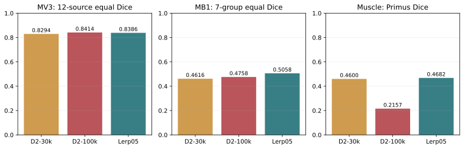
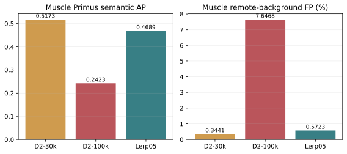
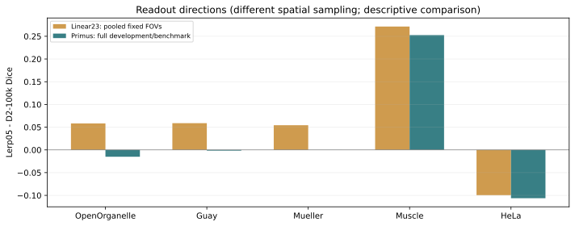
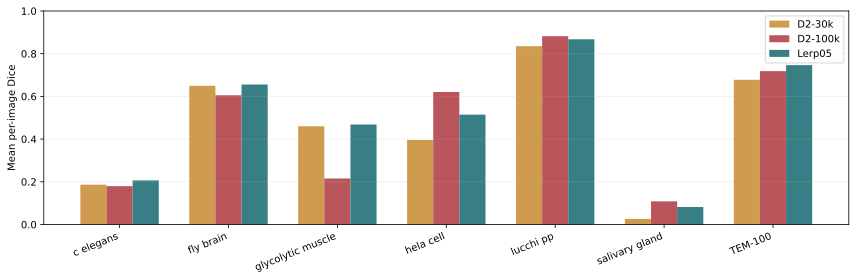

# Pilot B：D2预训练轨迹固定权重插值实验

固定中点恢复了肌肉的分割能力，并提高了MB1七组均值，但未完全保留100k在HeLa、OpenOrganelle等来源的收益。MV3来源等权Dice为0.838631（较100k -0.002748），MB1为0.505823（+0.030070）。保留Trajectory-Lerp05作为单Encoder轨迹融合基线；本轮停止，不搜索新系数。

## 实测结果

| 系统 | MV3来源等权Dice | MB1七组等权Dice | 肌肉Primus Dice | 肌肉AP | 肌肉远端FP |
|---|---:|---:|---:|---:|---:|
| D2-30k | 0.829407 | 0.461614 | 0.460026 | 0.517261 | 0.3441% |
| D2-100k | 0.841379 | 0.475754 | 0.215677 | 0.242346 | 7.6468% |
| Trajectory-Lerp05 | 0.838631 | 0.505823 | 0.468187 | 0.468882 | 0.5723% |

## 五个研究问题

### 1. MV3整体能力是否保持或改善？

没有超过D2/100k：Dice变化-0.002748（-0.275个百分点）。相对30k变化+0.009224。完整38区域均已评分；先对同来源区域取均值，再对12来源等权，不能用区域数加权的总均值替代。

| 来源 | D2/30k Dice | D2/100k Dice | 中点Dice | 中点−100k | 中点NSD@16nm |
|---|---:|---:|---:|---:|---:|
| casser20 | 0.930950 | 0.936792 | 0.935254 | -0.001538 | 0.915508 |
| guay21 | 0.747341 | 0.762715 | 0.761066 | -0.001649 | 0.643205 |
| haberl18 | 0.532842 | 0.540891 | 0.547271 | +0.006380 | 0.620052 |
| han24 | 0.703920 | 0.684636 | 0.678697 | -0.005938 | 0.473789 |
| jiang25 | 0.872588 | 0.883162 | 0.879882 | -0.003279 | 0.783081 |
| kunduri22 | 0.952804 | 0.951404 | 0.952491 | +0.001087 | 0.776988 |
| mekuc20 | 0.932114 | 0.931553 | 0.932114 | +0.000560 | 0.933838 |
| muller21 | 0.894623 | 0.896582 | 0.896649 | +0.000067 | 0.725292 |
| openorganelle | 0.763663 | 0.820650 | 0.805610 | -0.015040 | 0.640494 |
| turner22 | 0.771168 | 0.828157 | 0.816389 | -0.011768 | 0.669971 |
| wei20 | 0.923061 | 0.928623 | 0.928210 | -0.000413 | 0.811775 |
| xiao18 | 0.927803 | 0.931381 | 0.929939 | -0.001442 | 0.957709 |

### 2. 肌肉是否恢复，Recall付出了什么代价？

Primus Dice恢复了30k→100k损失的103.3%，AP恢复82.4%；超过100%的Dice恢复表示略高于30k。远端FP相对100k减少92.5%。肌肉Recall从0.380833到0.391853（+0.011021），这次Primus改善没有牺牲其平均逐层Recall。AP仍低于30k；远端FP仍高于30k，不声称所有指标完全恢复。

| 肌肉指标 | D2/30k | D2/100k | 中点 |
|---|---:|---:|---:|
| dice | 0.460026 | 0.215677 | 0.468187 |
| pixel_AP | 0.517261 | 0.242346 | 0.468882 |
| pixel_AUROC | 0.927059 | 0.698756 | 0.859489 |
| precision | 0.677326 | 0.153269 | 0.597122 |
| recall | 0.356516 | 0.380833 | 0.391853 |
| far_FP_rate | 0.003441 | 0.076468 | 0.005723 |
| nsd_16nm | 0.094191 | 0.025191 | 0.084883 |
| predicted_foreground_fraction | 0.016422 | 0.086021 | 0.020487 |

远端背景固定为同一原始XY平面距GT大于180nm的背景；FP率为这些背景像素中被预测为前景的比例。GT只用于评分。肌肉完整302层，AP/AUROC按层计算后取均值；空GT层的不可定义排名指标不伪造为零。

### 3. HeLa、OpenOrganelle、Guay收益是否保留？

三者均高于30k，但均未完全达到100k。下表列出保留的30k→100k Dice增益比例，作为描述性量度；没有据此选择系数。

| 来源/评测集合 | D2/30k | D2/100k | 中点 | 保留增益比例 |
|---|---:|---:|---:|---:|
| HeLa / MB1 | 0.395844 | 0.620713 | 0.514462 | 52.7% |
| OpenOrganelle / MV3 | 0.763663 | 0.820650 | 0.805610 | 73.6% |
| Guay / MV3 | 0.747341 | 0.762715 | 0.761066 | 89.3% |

### 4. Linear23与Primus方向是否一致？

肌肉两种读出都改善，HeLa两者都下降；OpenOrganelle出现方向分歧，继续说明Linear不能作为Primus的硬门槛。Linear在64个锁定随机视野内池化像素，Primus覆盖完整开发区域/benchmark体积；此处比较方向，不能把两者的绝对Dice/AP作等样本比较。

| 来源 | Linear23 Dice变化 | Linear23 AP变化 | Primus完整集合Dice变化 |
|---|---:|---:|---:|
| openorganelle | +0.058267 | +0.054568 | -0.015040 |
| guay21 | +0.058803 | +0.045238 | -0.001649 |
| muller21 | +0.054270 | +0.000259 | +0.000067 |
| glycolytic_muscle | +0.271365 | +0.228248 | +0.252509 |
| hela_cell | -0.099547 | -0.091648 | -0.106251 |

完整五来源AUROC、AP、Dice、Precision、Recall和远端FP见[Linear23表](../experiments/Pilot-B/PilotB_Linear23_comparison.csv)。新模型第23层有效秩以每来源相同512 token、3次重复统计，肌肉均值24.8292，介于30k的33.3074和100k的21.8166之间；谱变化本身不证明错误原因。新模型的15行谱统计和完整归一化谱分布保存在linear目录。

### 5. 是否值得研究训练阶段稳定性约束？

值得进入一项有对照的训练干预研究：现有证据表明同一轨迹的早晚权重包含可利用的互补性，且恢复肌肉不必损失Primus Recall；同时HeLa和部分开发来源的回退构成明确目标。下一次若获授权，只比较同一D2/30k初始化、同预算和采样的Vanilla continuation与一个结构保持约束，保留本轮固定中点作为基线。本轮不启动该实验。

SUPPORTED：固定0.5单Encoder组合改善了肌肉和MB1均值。未获得跨来源全面支配。INCONCLUSIVE：谱压缩是否导致错误、轨迹锚定是否为正确机制、某种新增SSL loss是否有效。两端点的Linear/Primus分别训练，读出与表征的交互仍存在。空间共模方向维持暂停，没有被直接干预证伪。

## 固定MB1七组

| Benchmark | D2/30k Dice | D2/100k Dice | 中点Dice | 中点−100k | 中点volume IoU |
|---|---:|---:|---:|---:|---:|
| TEM-100 | 0.677782 | 0.718240 | 0.746516 | +0.028275 | NA |
| c_elegans | 0.186429 | 0.179721 | 0.206498 | +0.026777 | 0.127332 |
| fly_brain | 0.649514 | 0.605428 | 0.655546 | +0.050118 | 0.516870 |
| glycolytic_muscle | 0.460026 | 0.215677 | 0.468187 | +0.252509 | 0.325740 |
| hela_cell | 0.395844 | 0.620713 | 0.514462 | -0.106251 | 0.399945 |
| lucchi_pp | 0.835239 | 0.882051 | 0.867514 | -0.014537 | 0.774742 |
| salivary_gland | 0.026465 | 0.108445 | 0.082040 | -0.026405 | 0.052181 |

MB1为已暴露诊断集，2595张图像/七组均完成；未用其标签选系数、阈值、checkpoint或训练参数。六体积的volume IoU由全部体素混淆数汇总，仍是逐层2D推理的语义输出，不是3D实例流程。TEM分辨率不可靠，nm指标留空；Salivary gland部分无前景预测导致HD95=inf，按既定规则保留。这里没有把结果与原论文3D实例成绩混排。

## 实际配置与可复现记录

| 项目 | 实际值 |
|---|---|
| 插值 | 两正式EMA，固定0.5；float64求均值后转回各原dtype |
| 参数验证 | 368键；367 FP32、1 BF16；0个非浮点状态；键/shape/dtype/finite/strict load通过 |
| Encoder | 单ViT-L/16，全程冻结；无新增推理参数 |
| Linear23 | 原312 train视野，500 AdamW更新，seed20261027，lr0.03，wd0.001，batch4096，来源/类别均衡 |
| 特征 | Pilot A原预处理，postnorm patch tokens，4个register token排除 |
| Primus | 官方原版Primus_Multiscale；[5,11,17,23]；156train/38dev；seed20261014；40k更新 |
| 优化 | batch1，AdamW lr1e-4，wd0.05，betas(0.9,0.98)，warmup100，cosine最低0.1，clip12 |
| 采样 | 来源等权、来源内合法Z；前景过采样0.5；与端点同初始化、同每步采样 |
| 输入/推理 | native-grid，(uint8/255−0.5)/0.25，灰度重复RGB；256窗口/128步幅，batch16，mean softmax，>0.5，TTA OFF |
| 标注 | 沿用MV-Generalist-v2；Han整幅GT，其余ignore规则不变 |
| 保存/选模 | 10k/20k/40k保存；固定40k评价，无择优延长 |
| 实测时长 | Primus 2592.87秒（43.21分钟，含既定监测）；有界全流程73.42分钟 |
| GPU | 训练/推理/距离评分使用允许的GPU1/2/3；GPU0未用于本轮；CPU只做I/O、调度、汇总和验证 |

两历史端点仅在肌肉补推理连续概率；全部302层的二值mask均与原保存预测逐像素一致（两组差异均0）。新模型无条件完成40k，Linear AP从未作为门槛。原始数据、历史模型及历史结果只读。

## Checkpoint与源码哈希

| 资产 | SHA256 |
|---|---|
| D2-30k正式EMA | `7db12e7ff8bee45166aaeeda1d94365e696ddaecf0c57a0d1611a891cf0d3eda` |
| D2-100k正式EMA | `92a81805f1cc126e1851d5c26baa0b5ba34597d8f93e29ac05203044fe6c7010` |
| 新中点EMA | `0d79edbd3b968eebbda4d3d57d6057632d4e793decebd301941782203b5a6c24` |
| 新Primus40k | `b3c7d9252cbb21e6512533c529990dba778184b1daf41118cff02754777dfe46` |
| 新Linear23 | `a0e0e631a97cdcf39edd13671f83ddb433625a4792ad86b83823b1a1727e53e1` |
| 共同初始head | `2ec39fb096d1a0eceb3124a9e08549d0c6ac82665dd71f8e2bc7b5a8d56f48ec` |
| 完整40k采样序列 | `45b8763f399df51c4455e4a791e6c32b2e9d6dfd9e5ba9ec988bbebb8b883d64` |

- Primus 10000步：`e9626cbb1dfa64db584c94898034ef87f4ae130986b00ae5dfb70570b0536b28`。
- Primus 20000步：`4d63dbcc6687a3b848f5f55922d5b20faf07973bd817428aaf1cdcba8e5656ec`。
- Primus 40000步：`b3c7d9252cbb21e6512533c529990dba778184b1daf41118cff02754777dfe46`。

实际运行源码为本地保留commit `2d3bcf4435569a7513a71a194e233e6a426f3132`。完整原始执行证据留在研究服务器和本地私有归档。公开交付只含最终代码、指标和必要的脱敏元数据：路径使用`${RESEARCH_ROOT}`/`${EXPERIMENT_ROOT}`，设备唯一标识及进程信息不发布。发布版common.py只改路径解析/解释器定位，七个其他运行文件字节一致；figures.py和validate_pilot_b.py为完成后绘图/复算。原始与发布源码/配置SHA分别记录，不把二者伪称为同一个文件。

模型权重、特征缓存、逐像素预测不进入Git。新模型定位见run_index及encoder.json；用资产SHA确认实际映射。独立PR基于已完成的Pilot A2分支，保留历史61条registry记录，仅新增本轮条目。

## 交付与停止

完整114条开发区域对照、36条来源汇总、38条配对差值、21条benchmark汇总、2595条新模型逐图指标、906条肌肉三系统AP记录及15条Linear汇总均单独保存。CSV包含Dice、Precision、Recall、HD95、NSD和预测前景比例。表格和图的独立算术核对、registry及仓库CPU检查结果见evidence/Pilot-B。

服务已停止且退出0，网站HTTP200，历史两端点SHA未变。无新SSL、Pilot C、Gram、TopoCL、LAST、SVD、层替换或额外融合；完成后停止。

独立[draft PR15](https://github.com/Polaris1010/EM-DINOv3-Research/pull/15)已推送，未合并；初始结果commit `370b6bd48023034b11b705dc49c6f2f3e506c162`，远程PR head已核对。
