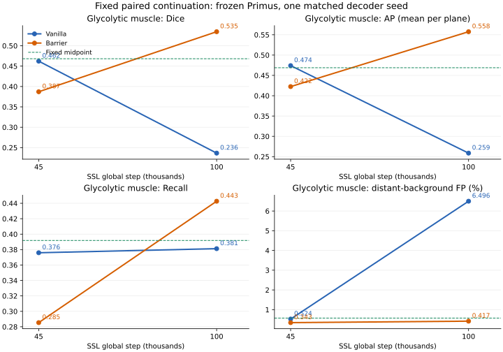

# Pilot C100：固定Barrier与Vanilla的100k配对终点评价

**研究决定：保留当前固定Barrier为MICCAI方法候选主线，结束本轮执行。** 100k时C1相对同预算C0的MB-1等权Dice提高0.049892，肌肉Dice提高0.298020、AP提高0.298814，Recall同时提高0.061474。开发集等权Dice下降0.001007。相对Pilot B固定中点，C1开发Dice提高0.002127、MB-1提高0.028946、肌肉Dice提高0.066314。长期结果修正了45k阶段过早淘汰该配置的建议；45k原始负结果保留。

两组各从自身已完成45k完整状态续训55,000次至100k，匹配Primus40k、Linear23、38开发区域及七组MB-1全部完成。实际流水线26.12小时，现已正常退出。

## 七系统总结果

Primus均为decoder seed20261014、固定step40k、TTA OFF。历史五系统复用既有同seed结果；本轮结果为一个匹配decoder seed。MV3先对区域求来源均值，再对12来源等权；MB-1先对二维切片/图像求组内均值，再对七组等权。

| 系统 | MV3 Dice | MV3 NSD@16nm | MB-1 Dice | 肌肉Dice |
|---|---:|---:|---:|---:|
| D2-30k | 0.829407 | 0.731270 | 0.461614 | 0.460026 |
| D2-100k | 0.841379 | 0.748817 | 0.475754 | 0.215677 |
| Trajectory-Lerp05 | 0.838631 | 0.745975 | 0.505823 | 0.468187 |
| C0_Vanilla_45k | 0.834000 | 0.741066 | 0.483744 | 0.462184 |
| C1_Barrier_45k | 0.830210 | 0.737635 | 0.486919 | 0.387123 |
| C0_Vanilla_100k | 0.841765 | 0.748065 | 0.484878 | 0.236481 |
| C1_Barrier_100k | 0.840758 | 0.747920 | 0.534770 | 0.534501 |

| C1净变化 | MV3 Dice | NSD | MB-1 Dice | 肌肉Dice | 肌肉AP | 肌肉Recall |
|---|---:|---:|---:|---:|---:|---:|
| 相对C0/100k | -0.001007 | -0.000144 | +0.049892 | +0.298020 | +0.298814 | +0.061474 |
| 相对Pilot B中点 | +0.002127 | +0.001945 | +0.028946 | +0.066314 | +0.088649 | +0.050819 |

主对照为绝对100k终点的C1−C0。两组沿原C-2各自的45k状态继续，方法分歧始于共同D2/30k；45k→100k的变化差只作描述。新C0/100k与历史D2/100k是分别执行的结果，分别保存。

## 肌肉：精度与召回同时恢复

| 系统 | Primus Dice | AP | AUROC | Recall | 远端背景FP率 |
|---|---:|---:|---:|---:|---:|
| D2-30k | 0.460026 | 0.517261 | 0.927059 | 0.356516 | 0.3441% |
| D2-100k | 0.215677 | 0.242346 | 0.698756 | 0.380833 | 7.6468% |
| Trajectory-Lerp05 | 0.468187 | 0.468882 | 0.859489 | 0.391853 | 0.5723% |
| C0_Vanilla_45k | 0.462184 | 0.474064 | 0.881961 | 0.375906 | 0.5241% |
| C1_Barrier_45k | 0.387123 | 0.422441 | 0.869546 | 0.285373 | 0.3426% |
| C0_Vanilla_100k | 0.236481 | 0.258717 | 0.712879 | 0.381199 | 6.4958% |
| C1_Barrier_100k | 0.534501 | 0.557531 | 0.911269 | 0.442673 | 0.4171% |

C1相对C0把远端FP率从6.4958%降到0.4171%，相对减少93.58%；Recall从38.1199%升至44.2673%。Dice与AP也同时提高，超出单纯减少预测前景的收益。

C0/45k→100k肌肉Dice由0.462184降到0.236481，AP由0.474064降到0.258717，远端FP由0.5241%升到6.4958%；同预算Vanilla已复现严重退化。C1同期Dice由0.387123升到0.534501，AP由0.422441升到0.557531，Recall由0.285373升到0.442673。其FP率从0.3426%轻微增加到0.4171%，仍远低于C0终点。绝对终点优势与变化方向一致。

图中线段连接两个固定终点，作为阶段变化示意。AP/AUROC为完整302层逐层计算后的均值；远端FP率按全部有效二维背景中距离GT>180nm的像素汇总。Linear23使用独立的固定视野集合和原生像素汇总，下面单独报告。

## 开发集逐来源损益

C1相对C0在9/12来源Dice提高、3/12下降。OpenOrganelle −0.021958、Turner −0.020211是主要代价；Haberl +0.016321和Han +0.007245是最大正项。Guay与Müller变化较小。

| 来源 | C0/100k | C1/100k | 中点 | C1−C0 Dice | C1−中点 Dice | C1−C0 NSD |
|---|---:|---:|---:|---:|---:|---:|
| casser20 | 0.936943 | 0.937385 | 0.935254 | +0.000442 | +0.002132 | +0.000078 |
| guay21 | 0.761513 | 0.761558 | 0.761066 | +0.000046 | +0.000493 | -0.002656 |
| haberl18 | 0.537121 | 0.553442 | 0.547271 | +0.016321 | +0.006171 | +0.014654 |
| han24 | 0.685346 | 0.692591 | 0.678697 | +0.007245 | +0.013893 | -0.006545 |
| jiang25 | 0.883164 | 0.884245 | 0.879882 | +0.001082 | +0.004363 | +0.002836 |
| kunduri22 | 0.951588 | 0.953742 | 0.952491 | +0.002154 | +0.001251 | +0.016667 |
| mekuc20 | 0.930801 | 0.932540 | 0.932114 | +0.001739 | +0.000427 | +0.003378 |
| muller21 | 0.896309 | 0.897011 | 0.896649 | +0.000702 | +0.000361 | +0.004138 |
| openorganelle | 0.831460 | 0.809502 | 0.805610 | -0.021958 | +0.003892 | -0.005531 |
| turner22 | 0.827331 | 0.807120 | 0.816389 | -0.020211 | -0.009269 | -0.031468 |
| wei20 | 0.928103 | 0.928885 | 0.928210 | +0.000783 | +0.000676 | +0.002170 |
| xiao18 | 0.931500 | 0.931076 | 0.929939 | -0.000424 | +0.001137 | +0.000548 |

HeLa属于MB-1，C1相对C0提高0.001519，相对中点提高0.120045。OpenOrganelle虽低于同预算C0，仍高于中点0.003892；Turner仍低于中点0.009269。这些来源损失保留在结论中。Han继承用户确认的整幅GT处理，不读取annotation mask。38区域配对数据见[PilotC100_paired_dev_deltas.csv](../experiments/Pilot-C100/PilotC100_paired_dev_deltas.csv)。

## MB-1七组固定诊断

| Benchmark | C0/100k | C1/100k | 中点 | C1−C0 | C1−中点 |
|---|---:|---:|---:|---:|---:|
| c_elegans | 0.203010 | 0.171117 | 0.206498 | -0.031893 | -0.035382 |
| fly_brain | 0.622040 | 0.651045 | 0.655546 | +0.029005 | -0.004502 |
| glycolytic_muscle | 0.236481 | 0.534501 | 0.468187 | +0.298020 | +0.066314 |
| hela_cell | 0.632988 | 0.634507 | 0.514462 | +0.001519 | +0.120045 |
| lucchi_pp | 0.879128 | 0.882480 | 0.867514 | +0.003352 | +0.014966 |
| salivary_gland | 0.107571 | 0.115168 | 0.082040 | +0.007596 | +0.033127 |
| TEM-100 | 0.712927 | 0.754570 | 0.746516 | +0.041643 | +0.008055 |

C1相对C0在6/7组提高，C. elegans下降0.031893。肌肉贡献MB-1总等权增益的85.3%；排除肌肉后，其余六组平均增益为+0.008537。收益集中在主要失败域，仍存在C. elegans与内部来源损失。相对中点，五组提高，C. elegans和Fly brain下降。

完整Dice、IoU、Precision、Recall、HD95 nm、NSD@16nm、预测前景比例及体素汇总IoU见[PilotC100_MB1_per_dataset.csv](../experiments/Pilot-C100/PilotC100_MB1_per_dataset.csv)；两新模型逐图文件各2595行。TEM缺少可靠空间标定的nm指标为空，空预测导致HD95为inf时保留原值。六体积的汇总IoU来自逐层二维推理。

## 匹配Linear23

仅在312个固定MV3-train视野拟合500步，seed20261027；五个随机诊断来源各64视野。原生像素AUROC/AP和固定阈值指标沿用既定定义；probe SHA固定后才评分开发/MB-1标签。所有Primus训练均按40k预算完成。

| 来源 | C0 AP | C1 AP | ΔAP | C0 Dice | C1 Dice | ΔDice |
|---|---:|---:|---:|---:|---:|---:|
| openorganelle | 0.790329 | 0.821260 | +0.030931 | 0.689797 | 0.724639 | +0.034841 |
| guay21 | 0.474437 | 0.478710 | +0.004272 | 0.487275 | 0.488841 | +0.001565 |
| muller21 | 0.640535 | 0.601039 | -0.039496 | 0.567331 | 0.492800 | -0.074531 |
| glycolytic_muscle | 0.272974 | 0.509828 | +0.236854 | 0.223664 | 0.501392 | +0.277728 |
| hela_cell | 0.621088 | 0.472589 | -0.148499 | 0.589963 | 0.433929 | -0.156034 |

肌肉Linear23 AP提高0.236854、Dice提高0.277728，与Primus的100k同预算方向一致。C1/100k的Linear23肌肉AP0.509828仍低于中点0.551012；Primus的肌肉AP则高于中点。Probe各自拟合，结果反映表征与读出的共同作用。谱统计独立保存，不据此追加谱机制断言。

## 实际执行和配对证据

两组分别完整恢复已核验的C0/C1 45k状态：student、EMA teacher、DINO/iBOT、AdamW及三rank的Python/NumPy/Torch/CUDA RNG，optimizer step45000→100000。继承原100k分段LR函数、WD0.04及原组倍率，BF16和clip30保持；没有重设续训cosine或optimizer。封存protocol中schedule说明文字仍残留旧30000..44999区间，实际trainer按45000..99999调用历史函数；rank日志、恢复检查与端点LR验证为执行依据。末步LR为1.0000000068296467e-6。

global batch48（3rank×16），原global256/local112×8、输入预处理、增强和DINO+iBOT+KoLeo cfg0.1及原crop scaling保持。两组使用原D2图像池和排除清单：MitoVerse153体积/34143合法Z，CEM1425433图像；只使用无标签图像。

C1固定λ1、margin0.05、bottom50%、Chebyshev distance>2、Layer23 post-norm patch token；CLS/register排除。固定原D2/30k EMA anchor对相同global图像unmasked eval/no-grad，Student保留iBOT mask与DropPath。选取anchor低相似非近邻有序patch对，FP32 affinity/hinge/reduction：

`L_Barrier = mean_selected max(0, A_student - stopgrad(A_anchor) - 0.05)^2`

Barrier加入同一次真实backward与optimizer update；全部165,000组rank-step输入、采样链、前后RNG、LR/WD相等，55k有效更新/模型，无恢复重放；每步hook确认Barrier upstream=1、anchor无梯度。生产模式无额外Student诊断forward或VJP。原30k anchor保持，未改为45k anchor。

两head继承MV-Generalist-v2的156 train/38 dev，encoder冻结、原版Primus_Multiscale、[5,11,17,23]、seed20261014、相同初始化及40k采样hash、native256/stride128/threshold0.5/TTA OFF、固定step40k。GPU1/2/3承担训练、推理及加速评分；GPU0未用，7860网站正常。没有官方Gram Anchoring、HRA、TopoCL、LAST或其他新增Loss。

实际运行commit `bd2ea834cb13163495c0d2d22c8df6467c76aa50`，14个源码和protocol结束后逐项重核。初始policy命名空间冲突在0次正式更新时退出并归档，改为continuation_policy后实际运行；历史文件保持。

## 耗时、显存与checkpoint

| 模型 | 55k SSL墙钟 | SSL img/s | rank0 step中位 | rank0 peak allocated | Primus40k |
|---|---:|---:|---:|---:|---:|
| C0_Vanilla_100k | 11.878 h | 61.74 | 748.6 ms | 9.53 GiB | 34.81 min |
| C1_Barrier_100k | 12.942 h | 56.66 | 813.8 ms | 10.72 GiB | 34.87 min |

C1 SSL墙钟增加8.95%，两组optimizer updates相同，C1额外anchor前向增加计算成本。两head并行；完整流水线26.12小时，新独立目录595.63GiB，包含全部55k阶段恢复checkpoint和缓存。

正常训练rank0 Barrier raw中位0.001226、激活比例中位9.12%；末1000步均值分别0.001580和10.25%。所有参与配对校验的loss、Barrier和必要梯度健康值有限，原裁剪配置保持。

| 模型 | 正式EMA SHA256 |
|---|---|
| C0_Vanilla_100k | `549aee676613da77082ddd1613ba8b502e3300c2f128d9feb889583cc4f42da8` |
| C1_Barrier_100k | `9188d26f90216ee966fb8f80fdfde9d33d685202b35e62fa78b34b5b41c073a4` |

完整full、EMA、head、probe的映射及SHA见[artifact_hashes.json](../evidence/Pilot-C100/artifact_hashes.json)。两45k full/EMA和原30k full/EMA共六个历史文件结束后重新计算SHA，与启动输入一致。418份小型输出逐文件下载并验证SHA；全部七系统38区域GT计数一致，来源/组均值独立重算误差<1e-12。历史67条registry记录保持。

## 科学裁决和停止

**SUPPORTED：** 在本条配对训练轨迹和固定下游协议内，当前Barrier在100k终点明显改善肌肉的Dice/AP及远端FP，同时提高Recall；MB-1总体优于匹配Vanilla和固定中点。C0在100k实际出现严重肌肉退化，补足了45k实验缺少的长期对照条件。

**CONTRADICTED：** 45k负结果足以淘汰当前Barrier的判断；100k所有来源一致改善的主张也与OpenOrganelle、Turner、C. elegans下降不符。

**INCONCLUSIVE：** 收益是否专门来自长期关系保持、周期纹理捷径的因果机制，以及多SSL/decoder seeds与新acquisition上的重复性。Student masked/DropPath与anchor unmasked eval存在前向条件差异；Barrier激活本身不等于遗忘。MB-1已参与研究决策，本轮作固定开发压力诊断，标签只用于最终离线评分。

**下一项研究决定：继续保留这一固定Barrier作为MICCAI候选主线，以同预算Vanilla和Pilot B中点为必须报告的基线。** 本轮已有长期净收益证据，不再用45k阶段表现将其提前淘汰；后续主张应围绕可复现的长期跨域性能稳定性和明确来源代价展开。新的重复性验证或方法机制实验需单独授权，本轮到此停止。

截至2026-10-30 03:31 HK服务器服务inactive、退出0、MainPID0，网站HTTP200，GPU0未用，训练与评测全部结束。原始图像/预测/大权重留在服务器；本次只交付小型指标、代码、协议、报告、工作记录和独立draft PR。

独立[draft PR#18](https://github.com/Polaris1010/EM-DINOv3-Research/pull/18)已提交推送，未合并；初始结果commit `e97cfc5209825546ca25df4c5c54847089b0a61a`，远程head已核验。
